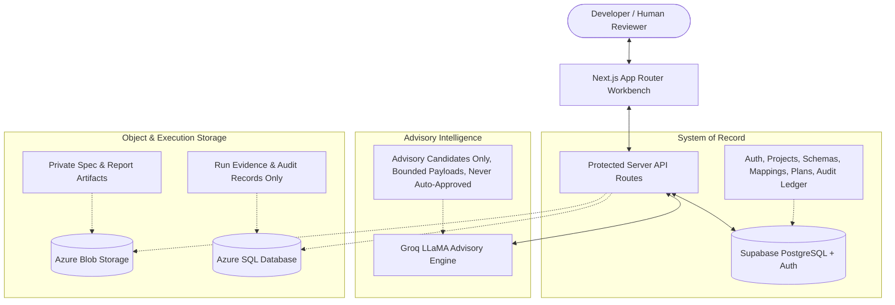

# UNIFLOW ∞ — API Compatibility Compiler

> Compare two API contracts, review mapping proposals, compile verified transformation plans, and build a deterministic, reproducible adapter between them.


---

## Non-Negotiable Core Principle

> **AI proposes; deterministic application code validates; humans approve ambiguous semantics.**
> 
> AI suggestions are advisory candidate mappings—they are never auto-approved into compilation, never execute dynamic code (`eval`), and never declare semantic correctness without human verification.

---

## Project Status & Implementation Progress

| Phase | Description | Status |
| :--- | :--- | :--- |
| **Phase 0** | System Architecture, Boundary Definition, Invariants & Decision Freeze | **COMPLETED** |
| **Phase 1** | Project Shell, Navigation, UI Primitives, Layouts & Theme Foundation | **COMPLETED** |
| **Phase 2** | Supabase Auth, PostgreSQL Migrations, RLS Policies & Tenant Isolation | **COMPLETED** |
| **Phase 3** | Spec Parsing, Schema Normalization & Pure Deterministic Diff Engine | **COMPLETED** |
| **Phase 4** | Server-Side Groq AI Advisory Engine, Bounded Payloads, Safety & Review UI | **COMPLETED** |
| **Phase 5** | Transformation Plan Compiler, Trusted Interpreter & Adapter Generation | *Next* |
| **Phase 6** | Equivalence Test Suite Execution, Evidence Persistence & Report Export | *Upcoming* |

---

## Architectural Highlights

### 1. Specification Import & Normalization (Phase 3)
- **Supported Formats**: OpenAPI 3.0.x / 3.1.x JSON, JSON Schema (draft-04/07/2020-12), and clearly labeled inferred Sample JSON.
- **Safety Bounds**: Conservative 1 MiB import ceiling, recursion depth capped at 64 levels, and local reference resolution cycle detection.
- **Prohibited External Calls**: Strictly rejects remote `$ref` URLs (`REMOTE_REF_PROHIBITED`) and external files to prevent SSRF and exfiltration.
- **OpenAPI Schema Picker**: Interactive root schema selection for multi-schema documents under `components.schemas`.
- **Bracket Path Notation**: Consistent, escaped path representation across all schemas (e.g., `$["customer"]["billing.address"]`, `$["items"][0]`).

### 2. Pure Deterministic Structural Diff Engine (Phase 3)
- Categorizes differences across 9 deterministic facets: `exact_match`, `renamed`, `type_conflict`, `missing_required`, `optional_to_required`, `nullability_conflict`, `enum_mismatch`, `shape_mismatch`, and `unsupported_keyword`.
- Zero LLM involvement in diff computation; stable IDs and inspectable structural facts.

### 3. Server-Side AI Advisory Engine (Phase 4)
- **Zero Client Key Exposure**: Groq API key is restricted exclusively to server-side environments (`lib/ai/groq.ts`). Health endpoints report status (`configured`, `model`) without revealing keys.
- **Bounded Payloads**: Only normalized schema facts and structural diffs are sent—raw source files and credentials are never transmitted.
- **Prompt Injection Defense**: Schema descriptions and field names are treated strictly as untrusted data. The system prompt instructs the model to ignore embedded override commands.
- **Strict Zod Parsing & Single Repair**: Model responses are validated against `GroqMappingResponseSchema`. If parsing fails, at most one bounded repair request is attempted.
- **Fabricated Path Defense**: Every proposed path is verified against normalized schema dictionaries. Hallucinated paths are eliminated.
- **Human Approval Gate**: Ambiguous semantics, missing required sources, differing enums, or type conversions automatically trigger `needs_confirmation` flags.

### 4. Human Review Workbench UI (Phase 4)
- **Side-by-Side Property Comparison:** Displays property inspections with uncertainty indicators (`LOW`, `MEDIUM`, `HIGH`, `UNKNOWN`) and AI-generated unresolved questions.
- **Interactive Review Actions:** Supports Accept, Reject, Edit, and detailed Audit Trail inspection to track changes and decisions.
- **Manual Mapping:** Provides a deterministic modal interface for creating and verifying field mappings without relying on AI.
- **Offline Resilience:** Automatically falls back to heuristic-based processing and manual mapping when Groq is unconfigured or unavailable, ensuring uninterrupted functionality.
---

## Service Ownership Boundaries



---

## Quick Start & Local Development

### Prerequisites
- Node.js >= 18.18.0
- npm >= 9.0.0

### 1. Installation
```bash
npm install
```

### 2. Environment Configuration
Copy the example environment configuration:
```bash
cp .env.example .env.local
```

Configure your credentials in `.env.local`:
```bash
# Supabase Configuration
NEXT_PUBLIC_SUPABASE_URL=https://your-project.supabase.co
NEXT_PUBLIC_SUPABASE_ANON_KEY=your-anon-key
SUPABASE_SERVICE_ROLE_KEY=your-service-role-key

# Groq AI Provider (Server-Side Only)
GROQ_API_KEY=gsk_your_groq_api_key_here
GROQ_MODEL=llama-3.3-70b-versatile
GROQ_FAST_MODEL=llama-3.1-8b-instant
GROQ_TIMEOUT_MS=15000

# Optional Azure Services (for Phase 6 evidence persistence)
AZURE_STORAGE_CONNECTION_STRING=
AZURE_STORAGE_CONTAINER_NAME=uniflow-specs
AZURE_SQL_CONNECTION_STRING=
```

### 3. Start Local Server
```bash
npm run dev
```
Navigate to [http://localhost:3000](http://localhost:3000) to open the UNIFLOW ∞ Workbench.

---

## Verification & Test Suite

All quality gates run and pass cleanly:

```bash
# Run 37 Unit & Equivalence Tests
npm test

# Run TypeScript Typecheck
npm run typecheck

# Run Linter
npm run lint

# Production Build
npm run build
```

---

## Documentation Index

- [Architecture & Boundaries](docs/architecture.md) — Service ownership and security model.
- [Decisions & Invariants](docs/decisions.md) — Frozen technical choices and path format specifications.
- [Phase Summary & Diff Log](DIFF.md) — Exhaustive changelog of Phase 3 and Phase 4 implementations.
- [Local Development Guide](docs/local-development.md) — Detailed instructions on setup, testing, and debugging.
- [Acceptance Checklist](docs/acceptance-checklist.md) — Acceptance criteria across security, parser limits, and compiler output.
- [Implementation Plan](docs/implementation-plan.md) — Phased delivery blueprint.
