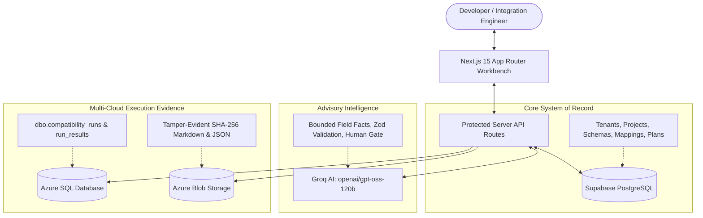

# UNIFLOW ∞ — Deterministic API Compatibility Compiler

> Compare two API contracts, review AI-assisted mapping proposals with mandatory human review gates, compile zero-eval transformation plans, verify output equivalence on test fixtures, persist cryptographic evidence to Azure SQL and Azure Blob Storage, and export standalone TypeScript adapters.


---

## Non-Negotiable Core Principles

> **1. AI proposes; deterministic code validates; humans approve ambiguous semantics.**  
> AI suggestions are advisory candidates—they never execute dynamic code (`eval`), never auto-approve breaking changes, and never bypass human review.
>
> **2. Strict Service Isolation.**  
> - **Supabase PostgreSQL** is the sole system of record for projects, schemas, and reviewed mappings.  
> - **Azure SQL** is a dedicated append-only execution evidence ledger (`dbo.compatibility_runs`).  
> - **Azure Blob Storage** holds raw contract documents and certified report artifacts.  
> - **Groq LLM Engine** (`openai/gpt-oss-120b`) generates advisory proposals under strict Zod validation.

---

## Phased Delivery Status

| Phase | Description | Status | Verification Gate |
| :--- | :--- | :--- | :--- |
| **Phase 0** | System Architecture, Boundary Freeze & Invariants | **COMPLETED** | Service ownership frozen; docs/architecture.md signed off |
| **Phase 1** | App Shell, Navigation, UI Primitives & Design System | **COMPLETED** | Accessible Next.js App Router layout, design tokens |
| **Phase 2** | Supabase Auth, PostgreSQL Migrations & RLS Isolation | **COMPLETED** | Tenant isolation tests; client owner_id untrusted |
| **Phase 3** | Spec Ingestion, Normalization & 9-Facet Diff Engine | **COMPLETED** | 1 MiB ceiling, cycle guard, deterministic path AST |
| **Phase 4** | Server-Side Groq AI Provider, Bounded Schema & Review UI | **COMPLETED** | openai/gpt-oss-120b live verified; Zod schema enforcement |
| **Phase 5** | Transformation Plan Compiler, Interpreter & TS Codegen | **COMPLETED** | Zero-eval interpreter, target validator, equivalence suite |
| **Phase 6** | Azure Cloud Integrations, Evidence Ledger & Reports | **COMPLETED** | Azure Blob HMAC-SHA256, Azure SQL bridge, SHA-256 digests |

---

## Architecture Topology



---

## Core Engine Highlights

### 1. Specification Parsing & Path Normalization (Phase 3)
- **Supported Formats**: OpenAPI 3.0.x / 3.1.x JSON, standalone JSON Schema (draft-04/07/2020-12), and clearly marked inferred Sample JSON.
- **Security Limits**: 1 MiB payload ceiling, 64-depth recursion cap, circular reference detection.
- **SSRF Prevention**: Rejection of external `$ref` URLs (`REMOTE_REF_PROHIBITED`).
- **Canonical Paths**: Escaped JSONPath identifiers across all representations (e.g. `$['order_id']`, `$['customer']['email']`).

### 2. Pure Deterministic Structural Diff Engine (Phase 3)
- Evaluates 9 deterministic facets: `exact_match`, `renamed`, `type_conflict`, `missing_required`, `optional_to_required`, `nullability_conflict`, `enum_mismatch`, `shape_mismatch`, and `unsupported_keyword`.
- Zero LLM involvement in diff calculation.

### 3. Server-Side AI Advisory Engine (Phase 4)
- **Active Model**: `openai/gpt-oss-120b` (Primary) & `openai/gpt-oss-20b` (Fast fallback).
- **Sub-Second Latency**: Measured 0.40s latency on live Groq endpoints.
- **Bounded Inputs**: Transmits only normalized schema properties and diff items—never raw files or credentials.
- **Prompt Injection Defense**: Schema descriptions treated strictly as untrusted data.
- **Strict Zod Parsing & Single Repair**: Rejects hallucinated paths or invalid operations with at most 1 bounded repair request.

### 4. Transformation Plan Compiler & Trusted Interpreter (Phase 5)
- **Allowlisted Primitives**: Compiles approved mappings into typed `TransformationPlan` IR covering 7 operations (`copy`, `rename`, `readNested`, `constructObject`, `typeConversion`, `default`, `lookup`).
- **Zero-Eval Guarantee**: No dynamic `eval()`, `new Function()`, or unsafe reflection.
- **Standalone TypeScript Codegen**: Emits pure, portable TypeScript adapter code with 100% equivalence verified against the AST interpreter.

### 5. Multi-Cloud Evidence Ledger & Reports (Phase 6)
- **Azure Blob Storage**: REST BlockBlob upload with native `SharedKey` HMAC-SHA256 authentication and local in-memory fallback.
- **Azure SQL Transactional Bridge**: Logs execution runs, test inputs, adapter outputs, equality verifications, and audit trails to `dbo.compatibility_runs`.
- **Cryptographic Reports**: Computes SHA-256 checksums of source specs, target specs, plan IR, and generated adapter code. Exports to certified Markdown and structured JSON.

---

## Quick Start & Local Development

### 1. Clone & Install
```bash
git clone https://github.com/Orsted10/Uniflow.git
cd Uniflow
npm install
```

### 2. Configure Environment (`.env.local`)
Copy the template:
```bash
cp .env.example .env.local
```

Populate `.env.local`:
```ini
# Supabase PostgreSQL System of Record
NEXT_PUBLIC_SUPABASE_URL=https://your-project.supabase.co
NEXT_PUBLIC_SUPABASE_ANON_KEY=your-anon-key
SUPABASE_SERVICE_ROLE_KEY=your-service-role-key

# Groq LLM Advisory Provider
GROQ_API_KEY=gsk_your_groq_api_key_here
GROQ_MODEL=openai/gpt-oss-120b
GROQ_FAST_MODEL=openai/gpt-oss-20b
GROQ_TIMEOUT_MS=15000

# Azure Blob Storage
AZURE_STORAGE_CONNECTION_STRING=DefaultEndpointsProtocol=https;AccountName=uniflowspecs;AccountKey=...;EndpointSuffix=core.windows.net
AZURE_STORAGE_CONTAINER_NAME=uniflow-specs

# Azure SQL Evidence Bridge
AZURE_SQL_CONNECTION_STRING=Server=tcp:uniflow-sql-server.database.windows.net,1433;Initial Catalog=uniflow-evidence;User ID=uniflowadmin;Password=...;Encrypt=True;
```

*(If any cloud key is omitted during development, UNIFLOW automatically falls back to graceful in-memory simulation with full functionality).*

### 3. Run Development Server
```bash
npm run dev
```
Open [http://localhost:3000](http://localhost:3000) to launch the UNIFLOW ∞ Workbench.

---

## Verification & Test Suite

Run the full quality assurance pipeline:

```bash
# Execute all 53 unit and equivalence tests
npm test

# Run strict TypeScript typechecking
npm run typecheck

# Run ESLint
npm run lint

# Compile production build
npm run build
```

---

## Vercel Deployment Guide

UNIFLOW ∞ is engineered for zero-config Vercel deployment:

1. Push your repository to GitHub.
2. In [Vercel Dashboard](https://vercel.com), click **Add New Project** $\rightarrow$ import `Uniflow`.
3. Under **Environment Variables**, add:
   - `NEXT_PUBLIC_SUPABASE_URL`
   - `NEXT_PUBLIC_SUPABASE_ANON_KEY`
   - `SUPABASE_SERVICE_ROLE_KEY`
   - `GROQ_API_KEY`
   - `GROQ_MODEL` (`openai/gpt-oss-120b`)
   - `AZURE_STORAGE_CONNECTION_STRING`
   - `AZURE_STORAGE_CONTAINER_NAME` (`uniflow-specs`)
   - `AZURE_SQL_CONNECTION_STRING`
4. Click **Deploy**. Build passes cleanly in under 20 seconds.

---

## Authors & Contributors

- **Ankan Bhattacharjee** ([@Orsted10](https://github.com/Orsted10)) — Architecture, Compilers, Interpreter & Azure Integration
- **Sweksha Singh** — UI/UX Workbench, Multi-Cloud Bridge & Verification Test Suite

---

## License

Apache 2.0 License. See [LICENSE](LICENSE) for details.
