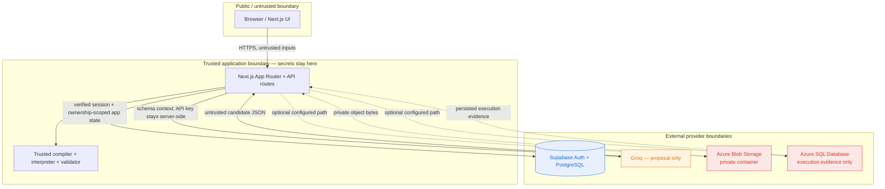

# Uniflow ∞ — architecture

Uniflow is an **API compatibility compiler**. It answers one question: *given a payload that conforms to one API contract, can it safely satisfy another contract, and what transformation is required to get there?*

It does this with a deterministic core, an optional AI suggestion step, and a trusted execution layer. AI may suggest; humans approve; the compiler validates; the interpreter executes; the validator and tests decide pass/fail.

## Service ownership

This product deliberately splits ownership so no two services duplicate the same job.

### Supabase — app system of record

Supabase owns the product’s primary state:

- authentication and user/project ownership
- projects
- source/target spec metadata and normalized schema metadata (not duplicate raw files)
- mapping sets and mapping decisions
- validated transformation plans
- test-run metadata (the application-level test-run record, not the detailed Azure execution evidence)
- generated adapter metadata and compatibility-report metadata
- Azure Blob artifact references

Supabase is the source of truth for everything the user directly creates and reviews.

### Azure Blob Storage — private file storage

Azure Blob stores actual imported spec files and generated report artifacts, in a private container only.

The app must continue working when Azure Blob is disabled or misconfigured. When it is unavailable, the app shows an explicit “Azure blob not configured” state and does not claim a live Azure feature works.

### Azure SQL Database — execution evidence only

Azure SQL stores a narrow execution-evidence domain:

- compatibility runs
- run inputs
- run results
- audit records

It is **not** a second source of truth for product state. It does not replace Supabase and does not receive copies of all Supabase tables. Supabase identifiers that appear here are logical references, not cross-database foreign keys.

### Groq — mapping proposal only

Groq is used server-side to propose candidate field mappings. Its output is parsed with Zod and constrained to an allowlist. Groq does not validate correctness, does not decide execution, and does not run code. The app never executes or eval arbitrary model-generated code.

### Vercel + Next.js — hosting

The Next.js app and its API routes run on an appropriate free hosting tier. Secrets stay server-side.

## Trust and secret boundaries

- **Browser boundary**: the browser sends untrusted spec data, payloads, and mapping edits. It never receives provider secrets.
- **Authentication/ownership boundary**: server routes derive the actor from the authenticated Supabase session and scope every project lookup/write by that actor. Browser-supplied owner IDs are never authoritative.
- **Human approval boundary**: the user approves, edits, or rejects each candidate mapping. The compiler cannot silently accept AI suggestions.
- **Compiler boundary**: only a typed transformation IR is executable. Arbitrary mappings or generated source are not executed directly.
- **Interpreter boundary**: execution uses trusted application code. No `eval`, no dynamic import of generated source, and no string-built SQL.
- **Validator boundary**: output must validate against the target normalized schema. A run is not “compatible” just because the interpreter produced output.
- **Secret boundary**: Supabase service-role credentials, Groq API key, and Azure credentials are server-only, must not use `NEXT_PUBLIC_*`, and must never be included in logs, reports, artifacts, or browser responses. Prefer session-aware Supabase access under RLS; any future service-role use requires explicit session validation and project ownership checks.
- **Untrusted imported-content boundary**: imported descriptions may contain prompt injection or hostile content. They are data, not instructions; they are not allowed to change system prompts or tool behavior.

## Input safety and normalized representation

### MVP import formats and limits

- Accept OpenAPI **3.0.x and 3.1.x JSON** and JSON Schema JSON. YAML is deferred until the JSON path works.
- An uploaded specification is limited to **1 MiB** before parsing. Reject larger content with an actionable error; do not silently truncate it.
- Parse JSON with `JSON.parse` inside a controlled error boundary. Validate the top-level structure, document version, and supported keyword subset before normalization. Never evaluate imported text.
- Bound structural recursion to **64 levels** and local reference resolution to **100 dereferences per document**; reject cycles or exceeded limits with a clear diagnostic.
- For OpenAPI, expose schema-root selection from `components.schemas`. This is not a promise to implement every operation, parameter, response, or OpenAPI extension.
- Resolve only supported local `#/$defs/...` and `#/components/schemas/...` JSON Pointer references (plus references to supported local schema locations). Reject or clearly flag remote/URL `$ref`s; never fetch them.
- Sample JSON schema inference is a demo fallback only and must be labelled “inferred”, not presented as an imported contract.

### One normalized schema model and path notation

Normalize supported JSON Schema/OpenAPI schema roots to a single internal node model with the supported structural fields: `type`, `properties`, `required`, `items`, `enum`, `const`, `format`, and `additionalProperties`, plus source location/diagnostics. Unsupported keywords are preserved as diagnostics or explicitly unsupported; they are not silently claimed as enforced.

Use one deterministic, JSONPath-like property path convention everywhere: root `$`; property segments encoded as bracketed JSON strings, e.g. `$[\"customer\"][\"display.name\"]`; array index segments as `[0]`. Wildcards, filters, and dynamic expressions are not valid mapping paths. Parse paths into literal property/index tokens and validate each token against the normalized schema before compiling. Use this exact convention for diff output, mapping review, compiler IR, interpreter, tests, TypeScript adapter generation, and reports.

## Records and sources of truth

| Record | Authoritative owner | Notes |
| --- | --- | --- |
| User identity, project, project ownership | Supabase Auth/PostgreSQL | RLS and session validation apply. |
| Spec metadata and normalized schema | Supabase PostgreSQL | Store file name, content type, hash, selected schema root, normalized representation, size, and Blob reference; do not mirror raw source files here. |
| Original imported spec and generated report file | Private Azure Blob | Actual bytes only; private container; app stores the reference in Supabase. |
| Mapping set, mapping decisions/history, validated plan | Supabase PostgreSQL | AI proposal is never an approval. |
| Application test-run metadata and generated adapter/report metadata | Supabase PostgreSQL | Detailed input/output execution evidence belongs in Azure SQL when enabled. |
| Compatibility run, run input, run result, audit event | Azure SQL | Narrow evidence domain; IDs referencing Supabase are logical references only. |
| Candidate mapping proposal | Groq output validated by app | Ephemeral proposal until persisted as a proposed mapping in Supabase. |

## Data flow

A typical vertical slice moves through these stages:

1. Authenticate.
2. Create or open a project.
3. Import a source contract and a target contract.
4. If the spec contains multiple schemas, optionally select a schema root.
5. Normalize both specs into one internal representation.
6. Compute a deterministic structural diff.
7. Optionally request candidate mappings from Groq.
8. Review, edit, accept, or reject mappings.
9. Compile a deterministic transformation plan from approved mappings.
10. Execute the plan against sample input in trusted code.
11. Validate the output against the target schema representation.
12. Run deterministic tests.
13. Generate a TypeScript adapter from the same validated IR.
14. Export an evidence-backed compatibility report.
15. Reload the project and confirm persistence.

Azure writes are part of this flow only when configured. They show their own success/failure state and never block the core workflow when they are unavailable.

## Failure paths

- **Supabase unavailable**: core app data paths degrade; durable user/project state cannot be maintained until Supabase is reachable again.
- **Groq unavailable or rejected**: skip the suggestion step; continue with manual mapping or already-proposed mappings.
- **Azure Blob disabled/unavailable**: core local workflow continues. Original spec/report bytes may be kept only in request/session scope or a local download path where implemented; no Blob reference or success is recorded. Long-term file durability is unavailable until Blob is configured.
- **Azure SQL disabled/unavailable**: local transformation, target validation, deterministic tests, adapter generation, and report generation can still run. Supabase stores only app-level test-run metadata/result summary; detailed inputs/results/audit evidence is explicitly marked not persisted, not claimed as Azure evidence.
- **Azure write fails after successful core execution**: core results remain useful, Azure status reports failure, and the report does not claim persistence that did not occur.

## What this architecture is for

This design supports the product’s academic and practical goals:

- Cloud Security: server-side secrets, ownership enforcement, private Blob access, input validation, least privilege, and a documented threat model.
- System Design: modular boundaries, explicit data flow, service ownership, and failure handling.
- DBMS: Supabase PostgreSQL plus a genuine Azure SQL workload for execution evidence with keys, joins, constraints, and transactions.
- PBL / DP-900: real Azure SQL and Azure Blob operations with evidence, screenshots, actual query results, and a clear relational-vs-object-storage contrast.

## Diagrams

### Architecture overview



### Vertical slice sequence

```mermaid
sequenceDiagram
    participant U as User
    participant App as Next.js App
    participant Supabase as Supabase
    participant Groq as Groq
    participant Compiler as Trusted compiler/interpreter/validator
    participant Azure as Azure Blob/SQL (optional)

    U ->> App: sign in
    App ->> Supabase: authenticate + ownership

    U ->> App: create project
    App ->> Supabase: persist project

    U ->> App: import source + target spec
    App ->> Supabase: store spec metadata
    App ->> Azure: store spec file if configured

    App ->> Compiler: normalize + deterministic diff
    Compiler -->> App: normalized schemas + diff
    App ->> Groq: request candidate mappings
    Groq -->> App: Zod-constrained suggestions

    U ->> App: accept/edit/reject mappings
    App ->> Supabase: persist mapping decisions

    App ->> Compiler: compile approved mappings
    Compiler -->> App: validated plan or diagnostics
    App ->> Compiler: execute sample + validate target + tests
    Compiler -->> App: output + validation/test evidence

    App ->> Supabase: persist run metadata
    App ->> Azure: persist evidence if configured

    App ->> App: generate TypeScript adapter
    App ->> App: export report
    App ->> Azure: store report artifact if configured

    Note over Azure: Azure paths are optional and<br/>show their own success/failure.
    Note over App: If Azure is disabled, core execution continues;<br/>only app-level run metadata remains in Supabase.
```

### Non-goals

- Arbitrary AI code execution.
- Python adapter generation for MVP.
- Currency/unit business rules.
- Automatic timezone removal.
- Microservices or Kubernetes.
- Guaranteed production-scale availability.
- Claims of universal equivalence beyond the fixtures that were actually tested.
